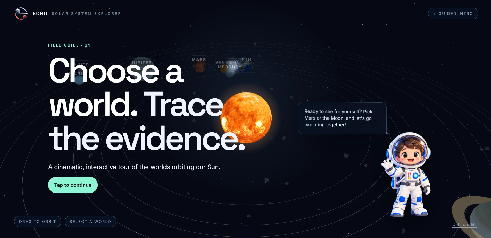

# ECHO · Solar System Explorer



ECHO is an educational web app that turns NASA mission data into a guided 3D field trip. Fly through the solar system, open the Moon or Mars, and meet the machines humans left there: where each one landed, what it did, and whether it can still contribute. Every claim is labelled **Known**, **Inferred** or **Unknown**, with links back to NASA datasets.

**Live site:** https://nasa-psi-three.vercel.app

## What you can do

- **Explore a 3D solar system** with real NASA planet textures, drifting meteoroids, a skippable intro and an astronaut guide who narrates.
- **Open any world** to see its facts, hotspots and layers, then jump into the Moon or Mars.
- **Find the tools on the globe.** Every Moon and Mars tool is pinned at its real latitude and longitude with a clickable name tag.
- **Inspect a tool in 3D.** The tool screen shows the machine rotating in the centre (drag to turn it, wheel to zoom), real photographs on either side, and the story below it.
  - Real NASA 3D models: Apollo Lunar Module (Antares, Eagle), InSight, Ingenuity, Perseverance.
  - A 3D Hasselblad Data Camera built by this team from reference photos, because no free scan exists.
  - Tools without a 3D model show their photo cut-out instead.
- **Dig into the evidence.** Dataset drawers link to NASA catalogs, and an Earthdata search finds more.
- **Test yourself** with a quiz per world.
- **Read the mind-maps.** Radial pages for Apollo 14 Antares, the Apollo 11 Hasselblad camera and InSight connect "What is this", "Mission timeline", "Discover the legacy" and "Can it still contribute?", with editable Known / Inferred / Unknown notes and replaceable images.
  - Apollo: `/mindmap/index.html` (toggle between Antares and the Hasselblad camera)
  - InSight: `/mindmap/mars.html`

## How it is built

```
Browser ─ Vite + TypeScript + three.js (frontend/)
   │       3D scene, tool screens, quiz, guide
   │       /mindmap/* are standalone React + Tailwind pages (loaded from CDNs)
   │  fetch /api/...
   ▼
Vercel serverless ─ api/index.js ─► compiled Express 5 app (src/)
                    routes → controllers → services → content store
                    helmet, CORS, rate limit, zod validation
                              │
                              ▼
                    data/*.json  (bodies, tools, quiz, astronaut script)
```

Node.js 20+, Express 5, TypeScript, zod and vitest on the back end. There is no database: content lives in JSON files under `data/`, validated at startup.

## Run it locally

```bash
npm install
npm run dev                    # API on http://localhost:3000
pnpm --dir frontend install
pnpm --dir frontend dev        # app on http://localhost:5173
```

Copy `.env.example` to `.env` if you want to change the defaults.

| Variable      | Default                 | Purpose                                                        |
| ------------- | ----------------------- | -------------------------------------------------------------- |
| `PORT`        | `3000`                  | Port the API listens on                                        |
| `CORS_ORIGIN` | `http://localhost:5173` | Origin allowed by CORS. Comma-separate to allow more than one. |

The Vite dev server proxies `/api`, `/images` and `/models` to the API, so no CORS setup is needed locally. For a separately hosted front end, set `VITE_API_BASE_URL` to the API origin and add the site to `CORS_ORIGIN`.

| Script                          | What it does                                                   |
| ------------------------------- | -------------------------------------------------------------- |
| `npm run dev`                   | Start the API with reload on change                            |
| `npm run build`                 | Compile `src/` to `dist/`                                      |
| `npm start`                     | Run the compiled server                                        |
| `npm test`                      | Run the vitest + supertest suite (44 tests, no network needed) |
| `npm run generate:placeholders` | Regenerate the SVG placeholder cards for tools without photos  |

## Deploying

`vercel.json` deploys the whole repository as one Vercel project: the front-end build is the static site, `public/` (images, 3D models) is copied next to it, and `api/index.js` serves `/api/*`. No environment variables are needed because the site and API share one origin. The rate limit is counted per function instance there, so it is approximate.

Commits must use an email that GitHub can match to your account (for example your `...@users.noreply.github.com` address), or Vercel blocks the deployment.

## API

| Endpoint | Returns |
| --- | --- |
| `GET /api/health` | `{ "status": "ok" }` |
| `GET /api/astronaut/script` | The narrator's lines |
| `GET /api/bodies` | All 11 bodies |
| `GET /api/bodies/:id` | One body plus its tool summaries (only Mars and the Moon have tools) |
| `GET /api/tools/:toolId` | One tool: facts, location, three images, optional `iconUrl` and `modelUrl` |
| `GET /api/quiz/:bodyId` | Quiz questions without answers (Mars and Moon) |
| `POST /api/quiz/:bodyId/answer` | `{ questionId, optionId }` → `{ correct, correctOptionId, explanation }` |

Tool ids: `curiosity`, `perseverance`, `ingenuity`, `insight` (Mars); `apollo-11-eagle`, `lunar-roving-vehicle`, `laser-retroreflector`, `chandrayaan-3-vikram`, `apollo-14-antares`, `hasselblad-camera` (Moon).

Behaviour worth knowing:

- **Errors** look like `{ "error": { "code", "message" } }` with `NOT_FOUND`, `VALIDATION_ERROR`, `INVALID_JSON`, `PAYLOAD_TOO_LARGE`, `RATE_LIMITED` or `INTERNAL_ERROR`.
- **Startup validation:** every file in `data/` is parsed with zod and cross-checked. If anything is wrong the server prints the file and field and exits with code 1.
- **Quiz answers** stay on the server; only the answer endpoint reveals `correctOptionId` and `explanation`.
- **Rate limit:** 100 requests per 15 minutes per IP on `/api/*`. Static files are not counted. Heavy clicking around the app can hit it, and the API then answers 429 until the window resets.
- **Paths** in responses (`/images/...`, `/models/...`) are relative to the API origin.

## Content and media

- `data/tools.json` holds every tool. `images.top`, `left` and `right` are photos or placeholders, `iconUrl` is a transparent cut-out pinned on the globe, and `modelUrl` is an optional `.glb` under `/models/`.
- Real photos are in place for Antares, the Hasselblad camera, InSight and Ingenuity. The other tools still use generated placeholder cards (their `credit` says "Placeholder illustration"). To replace one: add the file to `public/images/tools/`, update the `url`, `alt`, `caption` and `credit` in `data/tools.json`, and run `npm test`, which checks that every referenced file exists.
- 3D models are in `public/models/` and use Draco compression, so the front end self-hosts the decoder in `frontend/public/draco/`.
- Keys starting with `_` in the data files are maintainer notes and are stripped when loaded.
- `location.latDeg` is north-positive and `lonDeg` is east-positive (−180 to 180). Retrograde rotation (Venus, Uranus, Pluto) is expressed by an `axialTiltDeg` above 90, so renderers should not also flip the spin.

## Credits and licences

- **Planet, Moon and Sun textures:** Solar System Scope, CC BY 4.0 (https://www.solarsystemscope.com/textures/). See `frontend/REAL_TEXTURE_SOURCES.md`.
- **3D models:** NASA 3D Resources (https://science.nasa.gov/3d-resources/), free to use with credit: Apollo Lunar Module, InSight, Ingenuity, Perseverance.
- **Photos:** NASA, NASA/JPL-Caltech and NASA/LRO imagery, plus a ZEISS infographic and a Hasselblad product photo. The credits for the last two, and for the Antares and Hasselblad cut-outs, are not yet confirmed. Check them before publishing.
- **ECHO logo and the Hasselblad 3D model:** created by this team.
- NASA imagery is generally free to use with credit (https://www.nasa.gov/nasa-brand-center/images-and-media/). Other agencies have their own terms.

## Known limitations

- Only some tools have 3D models or real photos. The Hasselblad camera, lunar roving vehicle, laser retroreflector, Chandrayaan-3 and Curiosity have no NASA 3D model (Curiosity is published only as 3D-printing files).
- Earth imagery, active fires, the climate probe, data search, dataset links, credits and the Earth quiz use built-in fixtures; the API does not serve them yet. The "mean temp" fact shows "No data".
- If the API cannot be reached, the client falls back to its fixtures. The pill in the top-right reads "LIVE API" or "MOCK DATA".
- The mind-map pages need an internet connection (Tailwind, React and Babel load from CDNs), and uploaded images exist only in the visitor's browser.
- The seed facts were written from published NASA and ISRO figures and not all were checked against the sources. Items worth confirming each have a `_todo` note in the data files, for example Curiosity's landing coordinates, Ingenuity's position, the retroreflector pin, Chandrayaan-3's coordinates and the Hasselblad camera's mission.

Reference sources: NASA Planetary Fact Sheets (https://nssdc.gsfc.nasa.gov/planetary/factsheet/), NASA mission pages (https://science.nasa.gov), ISRO (https://www.isro.gov.in).
